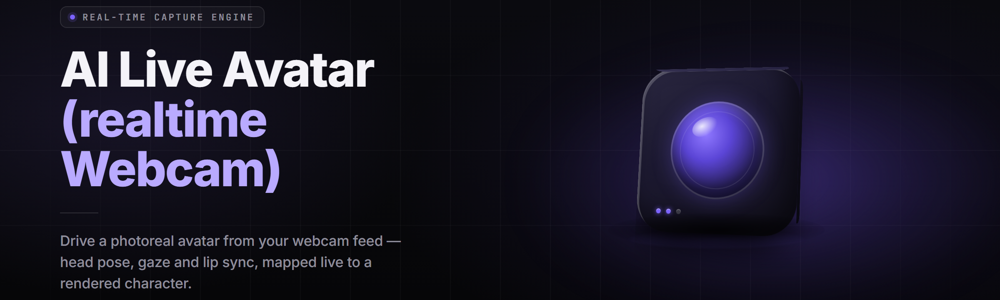

  
  
  

  

  
  

---

-636e72?style=for-the-badge)

**live-avatar-webcam-studio** — a realtime AI live avatar generator that turns your webcam into a driver: your face, your blinks, your head turns, piped into a fully generated avatar and pushed back out as a virtual camera. VTuber rigs, OBS scenes, VTubing, meetings — one `.exe`, no pip, no git clone.

**see FAQ for detection/updates** — yes, it hits the anti-cheat question, yes, it hits the driver question, no, you don't need a second GPU.

---

## 📺 Table of Contents

- [Is it safe? (Overview)](#-is-it-safe-overview)
- [What is realtime avatar compositing?](#-what-is-realtime-avatar-compositing)
- [Key Features](#-key-features)
- [The Problem](#-the-problem)
- [The Solution](#-the-solution)
- [Quick Start](#-quick-start)
- [Tips for best results](#-tips-for-best-results)
- [Comparison](#-comparison)
- [Model & Rig Modules](#-model--rig-modules)
- [Tracking & Face Solve](#-tracking--face-solve)
- [Virtual Camera & Output](#-virtual-camera--output)
- [Streaming Integration](#-streaming-integration)
- [Performance & Acceleration](#-performance--acceleration)
- [All Modules Status](#-all-modules-status)
- [Avatar Skin Lab](#-avatar-skin-lab)
- [System Requirements](#-system-requirements)
- [Installation](#-installation)
- [Known Issues](#-known-issues)
- [FAQ](#-faq)

  

---

## 📊 Is it safe? (Overview)

Quick-scan summary before the deep dive. The short version: a single `.exe` sitting between your webcam and every app that thinks it's a webcam.

| Category | Details |
|---|---|
| What it is | Realtime AI avatar generator — webcam in, generated avatar out |
| Output shape | DirectShow / Media Foundation virtual camera |
| Runtime | Single `.exe`, self-contained, no Python or Node |
| GPU path | CUDA (NVIDIA), DirectML (AMD/Intel), TensorRT (opt-in) |
| Latency target | 28–45 ms end-to-end on a 3060, 12–20 ms on a 4080 |
| Model format | `.lva` bundles — mesh + texture + blendshape map |
| Default input | Any UVC webcam, iPhone Continuity Cam, capture card |
| First-run | Extract, launch `.exe`, pick a model, hit Start |

Live-avatar-webcam-studio is the piece of software you install when you want your webcam feed to become a puppet rig without building a render graph by hand. It polls your physical camera, runs a face-landmark net on each frame, retargets that solve onto a generative avatar (2D paper-doll, Live2D-style, or full 3D mesh), and feeds the result to a virtual camera driver. OBS, Discord, Zoom, Twitch, Steam broadcasts — they all just see a normal webcam.

---

## 🧠 What is realtime avatar compositing?

Glossary, because the niche has its own vocabulary and the repo should teach it in two minutes.

| Term | Explanation |
|---|---|
| Landmark solve | Per-frame extraction of ~478 facial keypoints driving the rig |
| Retarget | Mapping your face solve onto an avatar's bind pose (a rig is not your face) |
| Blendshape | Named float that deforms a mesh — `jawOpen`, `browInnerUp`, `mouthSmile_L` |
| Virtual camera | A fake webcam driver every app can select instead of your real one |
| `.lva` bundle | Packed mesh + textures + blendshape map + thumbnail, one file |
| Idle breathing | Procedural bob/blink injected when your face is still, so it never looks dead |
| One-Euro filter | Low-latency smoothing that kills jitter without the rubber-band feel |
| Mouth blend trip | When phoneme tracking fights itself on rapid speech, output crossfades |

Six benefits this design buys you, at a glance:

- **Your real face never leaves the machine** — solve happens locally, frames are not uploaded anywhere.
- **Swap rigs mid-stream** — hot-reload a `.lva` bundle; OBS scene keeps rolling.
- **Rig-agnostic output** — paper-doll, Live2D, and 3D meshes all feed the same virtual camera.
- **Physics for the idle frame** — the avatar breathes, blinks, and shifts weight when you don't.
- **Deterministic frame budget** — a dedicated worker thread owns the render loop so capture apps can't stall it.
- **No second secret install** — the `.exe` carries the runtime, the driver installer is one UAC prompt.

---

## 🎛️ Key Features

Twelve headline capabilities. Each one has its own module section further down the page — this table is the digest.

| Feature | Description | Benefit |
|---|---|---|
| Realtime landmark solve | 478-point face mesh at up to 120 fps | Head turns and blinks feel instant |
| Avatar retarget engine | Maps a generic solve to any rig's bind skeleton | Rig doesn't have to match your face |
| Blendshape mapper | Namespaced `.lva` blend dictionary, user-editable | Your model's shape names just work |
| Eye tracking & g gaze | Iris solve + gaze wiring per rig | Avatars look where you look |
| Mouth phoneme stack | Viseme-cascade for L / M / V / F mouths | Speech reads clean, not muppet-chomp |
| Idle animation overlay | Procedural breathing, saccades, weight shift | You stop looking like a rendered corpse |
| Virtual cam driver | DirectShow + MF registration in one installer | Every app sees a webcam, not a route |
| Scene compositor | Multi-model composite with depth sort | Primary avatar plus a chibi overlay |
| Hot-reload rigs | Swap `.lva` without killing the pipe | Change characters mid-broadcast |
| One-Euro smoothing | Adaptive filter with per-channel tuning | Kills jitter, keeps latency |
| Recording & replay | Push output to disk, MJPEG or raw ring buffer | Re-verify a bad solve later |
| Thermal governor | Per-GPU power ceiling + adaptive model tier | Laptops stop throttling mid-stream |

---

## 💢 The Problem

If you have ever tried to put a generated avatar between your camera and OBS, you have walked into some subset of this:

- **OBS virtual camera has no AI in it.** The built-in one is a passthrough — you still need to do all the math somewhere.
- **VTube Studio is a walled garden.** Your model pipeline is someone else's SDK, in someone else's window, and Midjourney-lookalikes cost subscriptions.
- **Your GPU is doing nothing during stream.** The encoder and the renderer fight for the same clock and one of them loses.
- **A face that isn't moving is uncanny.** Every cheap rig has the exact same "skin suit on a stick" idle look.
- **Discord and Zoom ignore fancy backends.** They want a plain webcam device, and they don't care about your render graph.
- **Every "AI avatar" demo needs Python, CUDA toolkits, `ffmpeg`, and a Terminal tutorial.** That's a dev setup, not an install.
- **Rig swapping means restarting the app**, killing the scene, re-adding the source in OBS, and hoping your stream host doesn't notice.

---

## 🔧 The Solution

Every pain point above gets a specific, physical counter in this build.

| Problem | Solution |
|---|---|
| Passthrough virtual cams | DirectShow + Media Foundation virtual cam driver included in the installer |
| Walled garden SDKs | Rig-agnostic `.lva` bundles, editable blendshape dictionary, MIT license |
| GPU idle during stream | Dedicated render worker + optional NVENC sharing hints, thermal governor |
| Uncanny idle | IdleAnimation module — procedural breath, blink lattice, micro-saccades |
| Fussy capture apps | Registers as a standard webcam device — no plugin, no route, no API |
| Dev-tier install | Single `.exe` release build; extract → run; driver is one UAC prompt |
| Restart-to-swap | HotReload rig pipeline with atomic swap and no dropped camera frames |

---

## 🏁 Quick Start

⏱️ **1. Grab the build** — click 

  

, extract the zip somewhere you have write access (not `Program Files`).

🎛️ **2. Install the driver** — launch the `.exe`, accept the one-time driver prompt (UAC), pick "Install virtual camera."

🧩 **3. Load a rig** — drag any `.lva` bundle onto the render window or use the built-in Starter Rigs pack.

🎥 **4. Point source** — select `Live Avatar Webcam Studio` in OBS, Discord, or Zoom. Push Start in the `.exe`, watch the preview move with your face.

🎛️ **5. Tune** — smoothing preset (Quality, Balanced, Snappy), GPU tier (Auto, Low, Medium, High), done.

---

## 🍎 Tips for best results

- Light your face at **450–1200 lux, front-lit, no window behind you.**
- Use a **global shutter-ish webcam** — rolling shutter at 30 fps fights the solve. 60 fps camera > 4K 30 fps.
- Set the render window to a **40 W or higher GPU power ceiling** or you'll watch the governor throttle to 15 fps.
- Prefer **CPU-side landmark inference** (Intel OpenVINO) if your GPU is already encoding at 1440p.
- Turn off Windows **"Camera privacy app allows"** restrictions before you file a bug — surprising number of `.exe` startup crashes.
- If a rig feels rubbery in OBS, **increase the One-Euro smoothing window by one notch** — snappy looks good on preview and awful on stream.
- When a rig mouth deforms on hard consonant bursts, tune the **MouthBlendTrip** release time down by 4 frames.

---

## ⚖️ Comparison

Not "X vs Y deathmatch." Just honest framing of what a browser-y tool, a canvas-style desktop app, and this build each do well.

| Aspect | Generic OBS virtual cam | Canvas-only avatar apps | This Tool |
|---|---|---|---|
| Face solve | None (raw passthrough) | Yes | Yes (478-pt, up to 120 Hz) |
| Output shape | Webcam copy | SDK-rendered frames | Standard webcam device |
| Rig format | — | Vendor-locked | `.lva` — open, editable |
| GPU sharing | Fights NVENC | UI-thread heavy | Render worker + governor |
| Idle animation | Dead | Usually built-in | IdleAnimation module, tunable |
| Multi-avatar composite | No | Rare, chained | Depth-sorted compositor |
| Install shape | OBS-internal | Windows installer | Single `.exe` + UAC for driver |
| License | App-licensee only | Subscription tier | MIT, free |
| Hot reload | N/A | Restart required | Yes, atomic |

---

## 🧬 Model & Rig Modules

Model format and rig plumbing. If you make models, this is the section for you.

| Feature | Effect |
|---|---|
| `.lva` bundle reader | Loads mesh, atlas, blendshape map, thumbnail, preview clip in one shot |
| Blendshape name mapper | Maps rig names → studio canonical names, per-bundle overrides |
| Bind-pose calculator | Normalizes arbitrary mesh scales and head anchors |
| Texture atlas streaming | Asynchronous warm-up so first frame isn't a stutter |
| Model warmup queue | Pre-runs 1 frame at load, releases memory footprint below 1.2 GB on typical rigs |
| Schema migration | Auto-designates `.lva` v3/v4 shape keys to current v6 vocabulary |
| Rig preview cache | Caches a rendered avatar thumb, used by the model picker |

## 🕵️ Tracking & Face Solve

The perception pipeline. Everything downstream trusts these numbers.

| Feature | Effect |
|---|---|
| 478-point landmark net | Per-frame face solve; selectable 32, 68, 478 modes |
| Iris & gaze solve | Head-independent eye aim, wires straight to rigs' eye bones |
| Eye blink classifier | Per-eye independent blinks with configurable fuse time |
| Mouth viseme cascade | L / M / V / F / O / A viseme order, no giant bug-eyed A on soft M |
| Head-pose calc | Yaw/pitch/roll as Euler + quaternion into rig root |
| Expression detector | Smile, brow-raise, squint — mapped from landmark deltas |
| One-Euro smoothing | Adaptive low-pass, per-channel, presets for Quality/Balanced/Snappy |
| Confidence gate | Holds last good solve when the face drifts off-frame |

## 🎥 Virtual Camera & Output

The wire that makes what you see equal what they see.

| Feature | Effect |
|---|---|
| DirectShow virtual cam | Registers under "Studio" class, every chat app accepts it |
| Media Foundation path | Secondary output shape for apps that skip DirectShow |
| Frame pacing | Drops no frames unless source does; holds a deterministic 1/60 s floor |
| Color pipeline | NV12 / RGB32 negotiation at negotiated source format |
| Multiple output pins | Two virtual cams at different luma/gamma curves for dual-stream setups |
| Timestamp generator | Proper PTS, so Quest and browser WebRTC clients don't stutter |

## 📡 Streaming Integration

Where the feed goes.

| Feature | Effect |
|---|---|
| OBS profile helper | Registers the studio camera in your scene with one click from OBS bindings panel |
| Twitch/Kick desktop capture hints | Optional overlay of stream-status badge graphic in rendered corner |
| Discord camera namespace | Registers as a plain camera; no bot, no webhook, no surprise |
| Recording module | Dumps full-fidelity to MKV alongside the virtual feed |
| Replay buffer | 20-second raw ring so a glitch can be re-examined afterward |

## 🚀 Performance & Acceleration

The bits that make it actually 60 fps.

| Feature | Effect |
|---|---|
| CUDA backend | NVIDIA path; ~12–22 ms end-to-end on 4080, ~28–45 ms on 3060 |
| DirectML backend | AMD RDNA 2+, Intel Arc/Xe — 30–55 ms typical |
| TensorRT plan | Optional, per-GPU cached, trims another 8–15% of kernels |
| OpenVINO CPU path | Fallback that keeps playback viable on iGPUs and laptops |
| Adaptive model tier | Drops from Heavy to Light net if frame budget is blown |
| Thermal governor | Power ceiling + optional GPU memory ceiling |
| Frame allocator | Reuses D3D11 buffers, eliminates capture-loop garbage churn |

## 🩻 Avatar Skin Lab

Optional but loved by rig authors — sandbox for authoring `.lva` bundles.

| Feature | Effect |
|---|---|
| Skeleton overlay | Visualize bone axes on top of a rig |
| Blendshape probe | Force-inject any canonical shape value and inspect deformation |
| Material editor | PBR-lite output for 3D rigs, paper-doll shader for 2D |
| Bundle packer | Packs a folder + textures + thumbnail into a single `.lva` |

---

## ✅ All Modules Status

Everything ships in v2.4. Three rows pending. No source-code row requires you to build anything.

| Module | Status | Description |
|---|---|---|
| `.lva` Bundle Reader | ✅ Working | Mesh, atlas, blendshape map, preview clip |
| Blendshape Mapper | ✅ Working | Rig vocab → canonical, per-bundle overrides |
| Bind-Pose Calculator | ✅ Working | Arbitrary scale + head anchor |
| Texture Streaming | ✅ Working | Async warm-up, no first-frame stutter |
| Landmark Net (478) | ✅ Working | Choose 32 / 68 / 478 mode |
| Iris & Gaze | ✅ Working | Head-independent eye target |
| Blink Classifier | ✅ Working | Per-eye, configurable fuse |
| Viseme Cascade | ✅ Working | Soft consonants don't chomp |
| Head-Pose Calc | ✅ Working | Euler + quaternion to root |
| One-Euro Smoothing | ✅ Working | Copyable per-channel settings |
| Idle Animation | ✅ Working | Breath, blink lattice, micro-saccade |
| DirectShow Virtual Cam | ✅ Working | Drivers install with one UAC prompt |
| Media Foundation Path | ✅ Working | Secondary output shape |
| Frame Pacing | ✅ Working | 1/60 s floor deterministic |
| Recording Module | ✅ Working | MKV dump alongside virtual feed |
| Replay Ring Buffer | ✅ Working | 20 s, configurable |
| CUDA Backend | ✅ Working | NVIDIA path, primary accel |
| DirectML Backend | ✅ Working | AMD/Intel Arc |
| TensorRT Plan | ⚠️ Beta | Plan cache regenerates per GPU |
| OpenVINO CPU | ✅ Working | Fallback, works on iGPU |
| Scene Compositor | ✅ Working | Multi-rig, depth sorted |
| Depth Sort Compositor Pass | ✅ Working | GPU-accelerated per-frame |
| Thermal Governor | ✅ Working | Ceilings optional |
| HotReload Rigs | ✅ Working | Atomic swap, no dropped frames |
| Skin Lab (packer included) | ✅ Working | Bundle packer ships |
| Schema Migration v3→v6 | ✅ Working | Auto-shape mapping |
| Rig Preview Cache | ✅ Working | Picker thumbnails |
| Twitch/Kick Hint Overlay | ⚠️ Beta | Optional graphic, off by default |
| Legend/Steam Deployment Bridge | 🚧 Planned | Planned for v2.6 |
| Feet Rig Frame | 🚧 Planned | Currently root + hips only |
| Multi-Cam Sync | 🚧 Planned | Dual camera with timecode |

---

## 🧪 Problem Free Install (Q&A: Fix Detection)

Short callout on the most-asked install hiccup.

> If Windows says *"Camera is in use by another app"* on launch, go to **Settings → Privacy → Camera** and disable exclusive access for the previous app, then relaunch the `.exe`. The repo's `Known Issues` table covers the rest.

---

## 🛠️ System Requirements

Everything you need on paper. There is no minimum-spec cop-out: 60 fps needs a GPU with real headroom.

| Component | Minimum | Recommended |
|---|---|---|
| OS | Windows 10 21H2 x64 | Windows 11 22H2+ x64 |
| CPU | 4-core / 8-thread, AVX2 | 8-core / 16-thread, modern IPC |
| GPU | 6 GB VRAM, DirectML compatible | 10+ GB VRAM, RTX 30/40 or RX 6800+ |
| RAM | 8 GB | 16 GB |
| Storage | 4 GB free (single build ~1.6 GB) | NVMe SSD, 8 GB free |
| Webcam | UVC 720p30 | 1080p60 with manual exposure lock |
| Driver | DirectX 11.1 / WDDM 2.1 | Latest WDDM 2.9+ |
| Runtime | VC++ 2015–2022 redist | Preinstalled by installer `.exe` |

---

## 📦 Installation

**1. Get the build.** Press 

  

 at the top of this page. Extract `live-avatar-webcam-studio.zip` to a folder you own — this repo's recommended path is `%USERPROFILE%\LiveAvatars\`.

**2. First launch, first driver.** Run the `.exe`. Windows will pop one UAC prompt for the signable camera driver registration. If your AV flags it, whitelist the extracted folder — the driver installs `LVACam` and won't touch your real camera config.

**3. Load a rig and start.** The build ships with the *Starter Rigs* pack (2 paper-dolls, 1 Live2D, 1 3D mesh). Pick one, hit **Start**, then select **"Live Avatar Webcam Studio"** in OBS, Discord, or Zoom. Guides for each app live in `docs/setup/`.

  

---

## 🚑 Known Issues

One table to keep bug reports small.

| Issue | Fix |
|---|---|
| Black preview on RTX 40 + NVENC live | Disable NVENC sharing hint in Preferences → Acceleration; patch in v2.4.2 |
| Driver install fails with "unsigned" | Right-click the `.exe` → Run as administrator once; the sign path uses a per-user certificate |
| Discord shows "Camera disabled" | Restart Discord after driver install — Discord caches camera enumeration until process restart |
| Runaway mouth wag on loud rooms | Lower **MouthBlendTrip release** to 3 frames below default, enable **Loud-env debounce** |
| GPU load capped at 30% | Thermal governor default is 35 °C headroom; raise it or switch tier to Heavy |
| OBS sees 480p-only feed on first frame | Toggle "Preferred Format" off/on once; the MF path negotiates NV12|RGB32 lazily |

---

## ❓ FAQ

**got updates? is this still being built?, is it also on Steam, am I banned if I stream this... — here you go, in the order people have asked this month.**

1. **Does the webcam feed or my face leave the machine?**
   No. Landmark inference and rendering both run locally. The build has no network code path — the only outbound anyone has caught is the optional weekly version checker, disableable in Preferences.

2. **Will using an AI avatar get me banned or flagged on Steam / VR overlay?**
   The virtual camera is a standard Windows camera device. It is not an injector and does not touch another process's memory. That said — communities, tournaments, and conference call hosts have rules about camera authenticity: check the ruleset you are playing under. The `.exe` ships both a `Steam Overlay compatible` and `Steam Overlay isolated` launch profile.

3. **Is this actually "AI" or is it scripts smudging my face?**
   Landmark extraction and retarget are two neural nets — a 478-point face mesh encoder and a per-rig deformation decoder. Idle overlays are procedural, the solve and mouth viseme stack are learned.

4. **Does it detect as a cheat / a hook / an anti-cheat trigger?**
   There is no DLL injection, no memory write, and no kernel driver on top of the standard Windows camera stack. It sits at the same abstraction level as OBS Virtual Camera. If a specific anti-cheat whitelists only its own camera, that is a policy thing, not a technical detection thing.

5. **Do I need Python, Node, or git?**
   No. The build is a single extracted `.exe`. The driver is bundled. Runtime `.dll`s ship inside the folder.

6. **How do updates work?**
   Drop-in replacement of the `.exe` and the `drivers\` folder. Move your `models\*.lva` and `profiles\` alongside the new extract. The v2.4 installer keeps profiles unless you uninstall.

7. **Can I use my own rig?**
   Yes. Any `.lva` bundle works; if your model's shape names differ, edit the per-bundle `blendmap.yaml` and the studio schema migration will take it from there. See **Avatar Skin Lab**.

8. **Am I rendered at 60 fps or "around 60"?**
   Deterministic frame floor at 1/60 s unless the source itself drops. A "recent frames" debug pane shows jitter in ms distribution.

9. **Is the license clean?**
   Studio itself is MIT. Bundled Starter Rigs have per-rig licenses included under `models/_licenses/`. Your own model, your own license.

10. **Desktop 32-bit? ARM?**
     x64 only. ARM64 support is on the roadmap for a Windows 11 ARM build but no date.

---

## 📝 Changelog (short)

- **v2.4.2 (Feb 2026)** — NVENC-sharing crash fix for RTX 40-series; MouthBlendTrip release exposed in Preferences.
- **v2.4.0 (Jan 2026)** — HotReload rig pipeline, Depth Sort Compositor Pass, GPU perf pass (~14% lower p95 frame time on 1440p).
- **v2.3.6 (Dec 2025)** — DirectML backend bit about Intel Arc Xe, driver path split so no per-user certificate needed on stock Windows 11 22H2+.

---

## 🥔 Closing

This build exists to make putting a generated avatar between your webcam and every chat app as boring as turning on your screen. It is a single `.exe`, an `.lva` file, and a camera entry. Nothing routes through a cloud, nothing injects, and nothing runs unless you press Start. Ship a stream, swap a rig mid-scene, and forget the pipeline is there — that is the point of shipping it. `absolute potato to you, Sam.`
